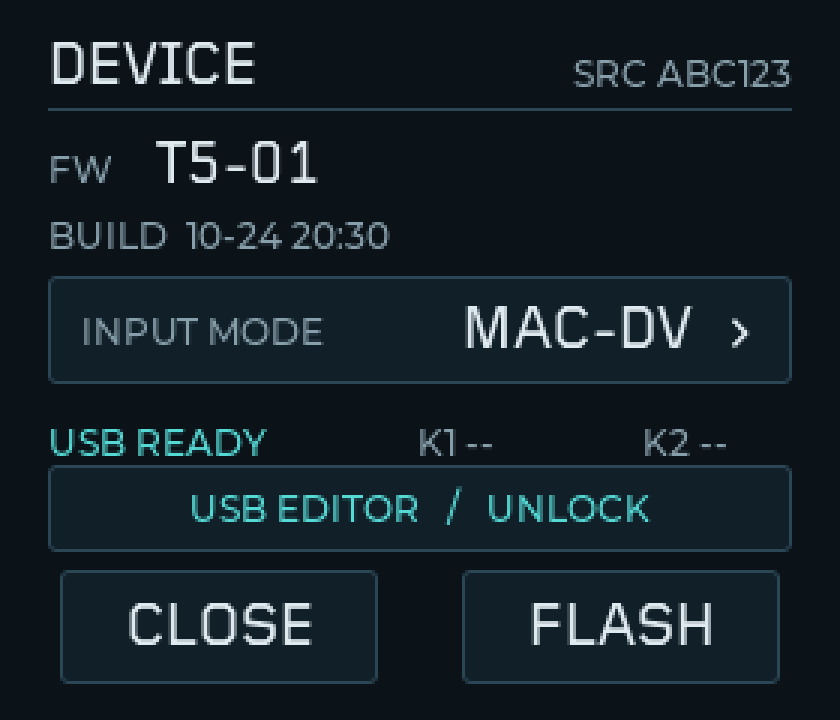
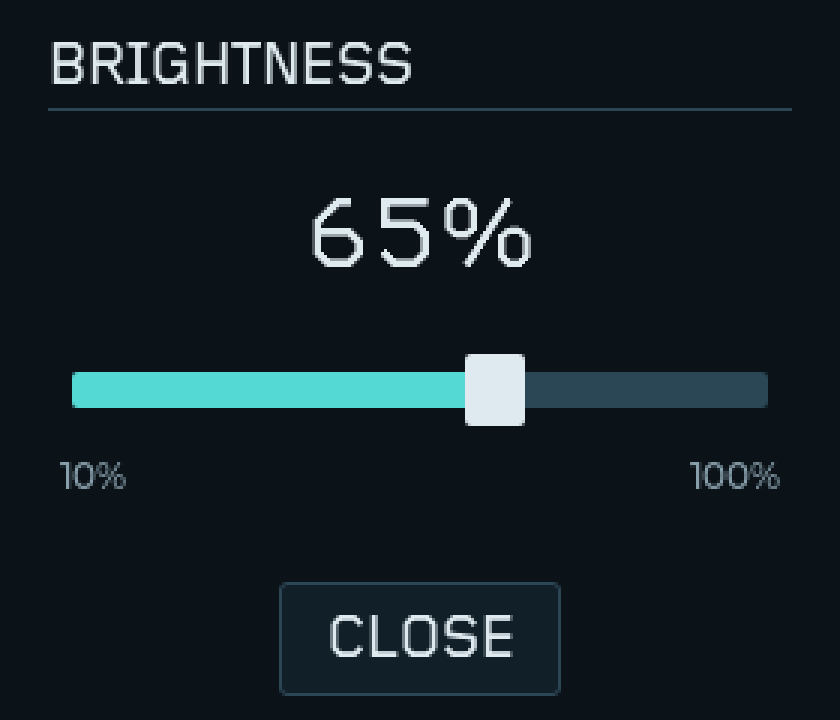
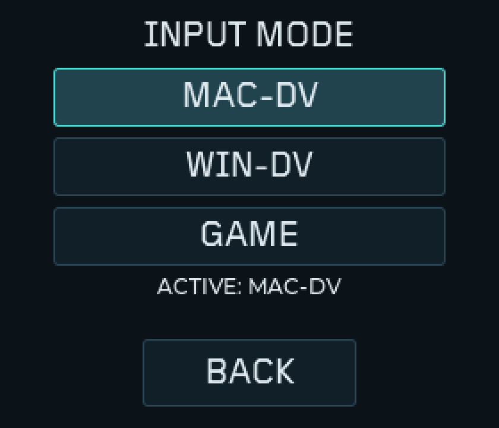
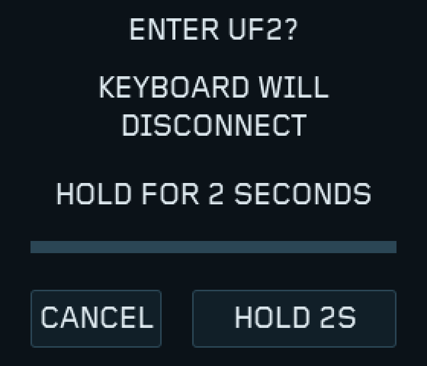

# T5-12 本地候选：控制页与USB Studio

Build、native、实际LVGL、ELF和UF2校验通过；未运行新远程CI。
2026-11-12 用户确认已刷完、没有问题、左右均可连接；浏览器RPC、完整快捷键、长时间/USB切换及新版休眠回归单独记录。
本地工作树含未提交实现，不宣称旧module固定SHA已包含这些改动。

| 用途 | 只刷目标 | 文件（firmware/build/） | 设备版本 / SOURCE |
|---|---|---|---|
| 第二次更换左主控，定向清旧K2 | Dongle | `prospector-dongle-left-slot-recovery-v2.uf2` | T5-12-LEFT2 / 26C690 |
| 完成配对后的正常新版 | Dongle | `prospector-dongle-controls-usb.uf2` | T5-12-USB / A9EA70 |
| 新左侧正常外设 | 新左侧 | `prospector-left-link-test.uf2` | 与T5-10L原文件逐字节相同 |

正常版FLASH523564B、静态RAM225320B、UF2末端0xA5E00，旧Bootloader余29184B。
维护版FLASH504384B、静态RAM216578B、UF2末端0xA1300，余48384B。
右侧原UF2、r2回退、v1维护文件和左侧原UF2的SHA均未变。

- 固定64KB池、32位真实LVGL：九层配置/三布局/目标默认12号字体，报告峰值36448B，
  测试末最大连续空闲24788B；120次页面开关无保留堆增长，120次切屏/双槽状态回归PASS。
- 64位主机64KB失败记录保留。64位对象占用更高，其较大池报告峰值57264B，不含池控制/块元数据。
  没有把64位失败改成通过，也没有通过提高目标固件64KB池来掩盖问题。
- native：设备服务四种配置、模式切换、完整mod-morph/快捷键、扫描策略/启动顺序、v1/v2恢复故障注入PASS。
- 生成DTS：九层×41键与r2绑定一致，41个物理键；Dvorak输出及修饰键掩码不变。
- ARM实际ELF BLE/settings→central→observer顺序、UF2向量/连续块/写入上限均PASS。
- 正常版不包含维护；Studio仅UART/USB，BLE transport关闭；ATT3、q64与r2扫描策略保留。

日志：`firmware/build/reports/t5-12-heap-and-ui-final.log`、`t5-12-native-final.log`、
`t5-12-left2-native.log`、`t5-12-dts-contract.log`、`t5-12-controls-usb-build-final2.log`、`t5-12-left2-build.log`。
两个JSON分别记录SHA-256、配置、资源及源码指纹。

[逐步刷机、配对和浏览器查看键位](../../docs/31-controls-usb-studio.md)。

下面是实际LVGL源码的主机模拟图，版本/日期/SOURCE/连接状态为模拟值，不是实机验收照片。

